# UT03. Práctica 1. Instalación de Odoo 17 (sobre Docker)

| | |
|---|---|
| **Módulo** | Sistemas de Gestión Empresarial (DAM2) |
| **Unidad** | UT03. Instalación y configuración de sistemas |
| **Profesor** | Enrique Nogués Julián |
| **Nombre y apellidos** | Oliver Bitica |
| **Curso** | 2026-27 |
| **Fecha** | 28/10/2026 |

---

## Índice

0. Introducción
1. Preparación de las carpetas en el NAS
2. Despliegue de los contenedores con Portainer
3. Creación del usuario `odoo` en PostgreSQL
4. Fichero de configuración de Odoo (`odoo.conf`)
5. Creación de la base de datos de Odoo
6. Comprobación de wkhtmltopdf (generación de PDF)
7. Odoo como servicio
8. Acceso a la base de datos con `psql`
9. Acceso a la base de datos con pgAdmin
10. Acceso remoto a Odoo con proxy inverso
11. Bibliografía

---

## 0. Introducción

La práctica consiste en instalar Odoo 17 con PostgreSQL. La idea original era hacerlo en una máquina
virtual con Ubuntu Server 24, pero el profesor me dejó hacerlo con **Docker**, así que lo he montado en mi
NAS Synology, que tengo en casa funcionando como servidor. Los contenedores los gestiono con
**Portainer**, y al final también he configurado un **proxy inverso** para poder entrar a Odoo desde
fuera de casa con HTTPS.

Al usar Docker algunos pasos cambian bastante. Esta tabla resume cómo he resuelto cada parte:

| Paso de la práctica                         | Cómo lo he hecho con Docker                                      |
|---------------------------------------------|------------------------------------------------------------------|
| Máquina virtual Ubuntu Server               | Contenedores en el NAS, gestionados con Portainer                |
| Instantáneas de la VM                       | Los datos se guardan en carpetas del NAS                         |
| Descargar Odoo con `git clone` y dependencias | La imagen oficial `odoo:17` ya trae todo                       |
| Instalar PostgreSQL                         | Contenedor `postgres:16`                                         |
| `createuser --createdb --pwprompt odoo`     | El mismo comando, en la consola del contenedor de PostgreSQL     |
| Instalar wkhtmltopdf                        | Ya viene en la imagen de Odoo (lo compruebo generando un PDF)    |
| `/home/odoo/conf/odoo-server.conf`          | `odoo.conf` en la carpeta `/volume1/docker/odoo17/config` del NAS (dentro del contenedor es `/etc/odoo/odoo.conf`) |
| Servicio con `systemctl`                    | Start/Stop/Restart del contenedor y `restart: unless-stopped`    |
| Editar `postgresql.conf` y `pg_hba.conf`    | La imagen de PostgreSQL ya viene preparada                       |

**Lo que he usado:**

- **Servidor:** NAS Synology (8 CPU, 19,5 GB de RAM) con Docker 24.0.2.
- **Portainer CE 2.33.1** para gestionar los contenedores.
- **Imágenes:** `odoo:17` (Odoo 17.0) y `postgres:16` (PostgreSQL 16.13).
- **Mi PC con Windows**, conectado a la red de casa por VPN (OpenVPN), con el navegador y pgAdmin 4.

> **Nota:** en algunas capturas he censurado datos personales y de seguridad (contraseñas, correo,
> teléfono y parte del dominio de mi servidor).

---

## 1. Preparación de las carpetas en el NAS

Lo primero fue crear las carpetas donde se van a guardar los datos de Odoo y de PostgreSQL. Si los datos se
quedaran solo dentro de los contenedores, se perderían al borrarlos o actualizarlos. Guardándolos en el
NAS no pasa eso, y además entran en las copias de seguridad.

| Carpeta en el NAS                 | Ruta dentro del contenedor  | Para qué sirve                       |
|-----------------------------------|-----------------------------|--------------------------------------|
| `/volume1/docker/odoo17/config`   | `/etc/odoo`                 | Fichero de configuración `odoo.conf` |
| `/volume1/docker/odoo17/addons`   | `/mnt/extra-addons`         | Módulos propios                      |
| `/volume1/docker/odoo17/data`     | `/var/lib/odoo`             | Adjuntos y sesiones de Odoo          |
| `/volume1/docker/odoo17/postgres` | `/var/lib/postgresql/data`  | Base de datos de PostgreSQL          |

Las creé desde **File Station**, dentro de la carpeta compartida `docker`:

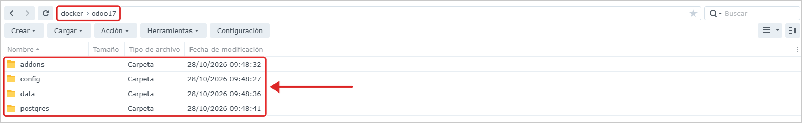

Además, cada carpeta tiene que pertenecer al usuario con el que funciona cada contenedor, porque si no, no
pueden escribir en ellas. Lo miré con `id odoo` e `id postgres` dentro de cada imagen:

| Contenedor   | Usuario    | uid:gid   | Carpetas                    |
|--------------|------------|-----------|-----------------------------|
| `odoo17`     | `odoo`     | `101:101` | `config`, `addons`, `data`  |
| `odoo17-db`  | `postgres` | `999:999` | `postgres` (permisos `700`) |

Para cambiar el propietario usé estos comandos:

```bash
chown -R 101:101 /volume1/docker/odoo17/config /volume1/docker/odoo17/addons /volume1/docker/odoo17/data
chown -R 999:999 /volume1/docker/odoo17/postgres
chmod 700 /volume1/docker/odoo17/postgres
```

---

## 2. Despliegue de los contenedores con Portainer

Para levantar Odoo y PostgreSQL creé un *stack* en Portainer (**Stacks → Add stack**). Un stack es un
grupo de contenedores definidos en un fichero `docker-compose`. Le puse de nombre `odoo17` y pegué el
fichero en el **Web editor**.

Este es el `docker-compose` completo:

```yaml
services:
  db:
    image: postgres:16
    container_name: odoo17-db
    restart: unless-stopped
    environment:
      POSTGRES_USER: postgres
      POSTGRES_PASSWORD: postgres
      POSTGRES_DB: postgres
    volumes:
      - /volume1/docker/odoo17/postgres:/var/lib/postgresql/data
    ports:
      - "5433:5432"

  odoo:
    image: odoo:17
    container_name: odoo17
    restart: unless-stopped
    depends_on:
      - db
    environment:
      HOST: db
      USER: odoo
      PASSWORD: odoo
    volumes:
      - /volume1/docker/odoo17/config:/etc/odoo
      - /volume1/docker/odoo17/addons:/mnt/extra-addons
      - /volume1/docker/odoo17/data:/var/lib/odoo
    ports:
      - "8069:8069"
```

Qué hace cada parte:

- **`db`** es el contenedor de PostgreSQL 16. Con las variables `POSTGRES_*` se crea el superusuario
  `postgres` con contraseña `postgres`. Lo publico en el puerto **5433** del NAS para conectarme luego con
  pgAdmin (por qué no el 5432 lo explico en las incidencias).
- **`odoo`** es el contenedor de Odoo 17. Con `HOST`, `USER` y `PASSWORD` le digo cómo conectarse a la base
  de datos. `db` es el nombre del otro servicio, y Docker lo resuelve solo dentro de su red interna. Odoo
  queda en el puerto **8069**.
- **`depends_on`** hace que la base de datos arranque antes que Odoo.
- **`restart: unless-stopped`** hace que los contenedores arranquen solos cuando se enciende el NAS o si
  se caen.

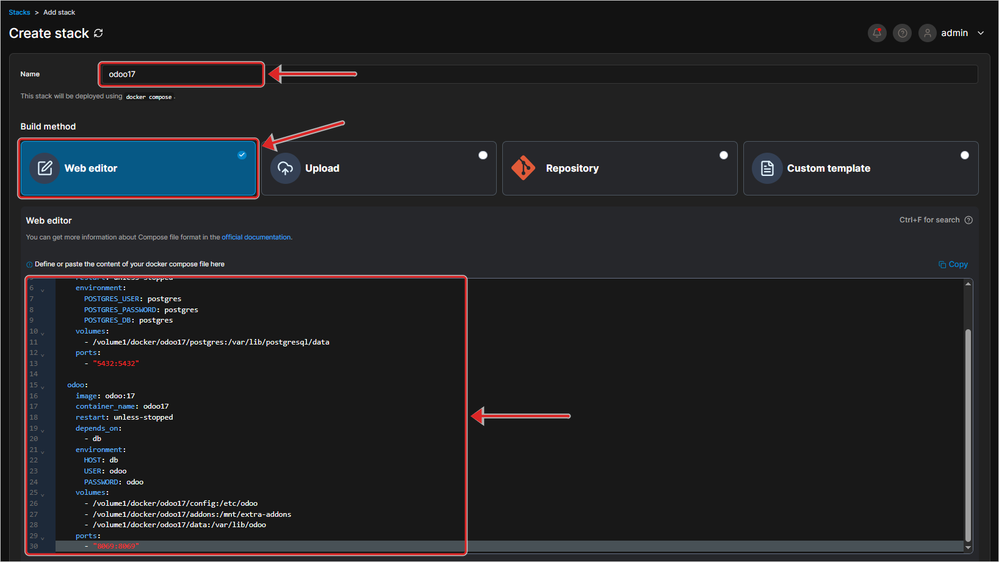

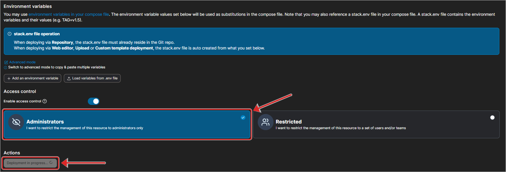

Al darle a **Deploy the stack**, Portainer descarga las imágenes y crea los dos contenedores, `odoo17` y
`odoo17-db`:

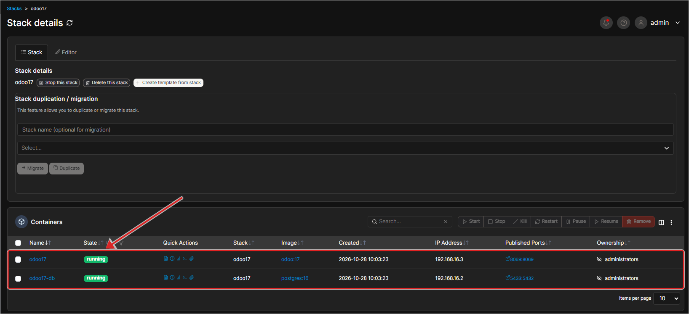

### 2.1. Incidencias

**El primer despliegue falló** con el error «Unable to deploy stack». El problema era que **el puerto
5432 ya estaba ocupado**: el propio sistema del NAS (DSM) tiene un PostgreSQL interno que usa el
`127.0.0.1:5432`. Lo solucioné publicando mi PostgreSQL en el **5433** (`"5433:5432"`). Dentro del
contenedor sigue usando el 5432, así que para Odoo no cambia nada.

**Después Odoo se reiniciaba en bucle.** En los logs salía `No section: 'options'`. Era porque la carpeta
`config` estaba vacía y Odoo no encontraba su `odoo.conf`. Lo arreglé en el apartado 4, después de crear el
usuario de la base de datos.

---

## 3. Creación del usuario `odoo` en PostgreSQL

Odoo no deja conectarse con el superusuario `postgres`, así que hay que crear un usuario para él. Lo llamé
`odoo`, con permiso para crear bases de datos (`--createdb`) y con contraseña `odoo` (`--pwprompt` hace que
la pida por teclado).

Para ello abrí una consola dentro del contenedor de PostgreSQL desde **Portainer → Containers →
odoo17-db → Console**, con el comando `bash` y el usuario `postgres`:

```bash
whoami                                   # para comprobar que soy el usuario postgres
createuser --createdb --pwprompt odoo    # contraseña: odoo
psql -c "\du"                            # para ver los roles
```

En la lista de roles aparece el nuevo `odoo` con **Create DB** (no es superusuario) y `postgres` como
**Superuser**:

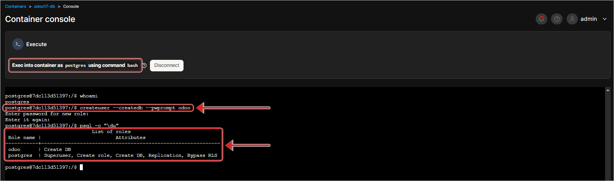

---

## 4. Fichero de configuración de Odoo (`odoo.conf`)

Odoo lee su configuración de `/etc/odoo/odoo.conf`, que en mi caso es la carpeta `config` del NAS. Escribí
el fichero en el Bloc de notas:

```ini
[options]
addons_path = /mnt/extra-addons,/usr/lib/python3/dist-packages/odoo/addons
data_dir = /var/lib/odoo
db_host = db
db_port = 5432
db_user = odoo
db_password = odoo
proxy_mode = True
```

| Parámetro                 | Para qué sirve                                                         |
|---------------------------|------------------------------------------------------------------------|
| `addons_path`             | Dónde están los módulos: los míos (`/mnt/extra-addons`) y los de Odoo  |
| `data_dir`                | Carpeta donde Odoo guarda adjuntos y sesiones                          |
| `db_host`                 | Servidor de PostgreSQL. Es `db`, el nombre del servicio en Docker      |
| `db_port`                 | Puerto de PostgreSQL dentro de Docker (5432)                           |
| `db_user` / `db_password` | El usuario `odoo` que creé en el apartado 3                            |
| `proxy_mode`              | Lo necesito para el proxy inverso del apartado 10                      |

La contraseña maestra (`admin_passwd`) no la puse, porque Odoo la añade solo al crear la primera base de
datos.

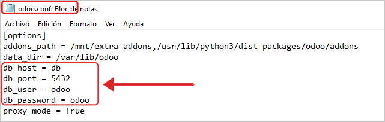

Luego lo subí a la carpeta `config` con **File Station → Cargar**:

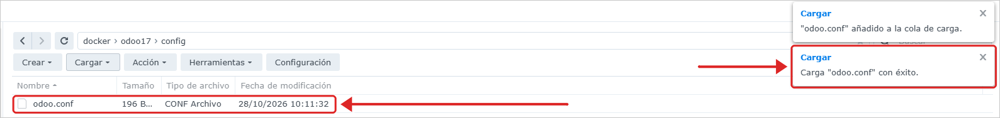

Reinicié el contenedor `odoo17` y en los logs ya se ve que arranca bien. Usa el fichero de configuración,
se conecta a la base de datos como `odoo@db:5432`, encuentra wkhtmltopdf y se queda escuchando en el
puerto 8069:

```
INFO ? odoo: Odoo version 17.0-20260908
INFO ? odoo: Using configuration file at /etc/odoo/odoo.conf
INFO ? odoo: database: odoo@db:5432
INFO ? odoo.addons.base.models.ir_actions_report: Will use the Wkhtmltopdf binary at /usr/local/bin/wkhtmltopdf
INFO ? odoo.service.server: HTTP service (werkzeug) running on 6bb6efb1a7cf:8069
```

En la captura, arriba sale el error de antes (cuando no existía `odoo.conf`) y abajo el arranque correcto:

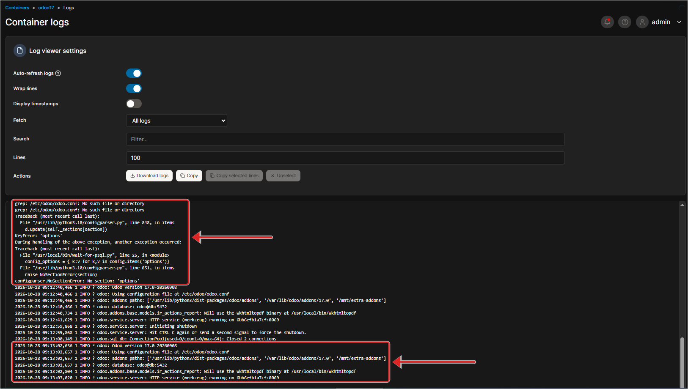

---

## 5. Creación de la base de datos de Odoo

Con Odoo funcionando entré desde el navegador a `http://192.168.1.200:8069` (la IP del NAS), conectado por
la VPN. Como todavía no había ninguna base de datos, Odoo muestra el formulario para crear la primera.
Lo rellené así:

- **Master Password:** dejé la que genera Odoo. Odoo la guarda cifrada en `odoo.conf` y la pide para
  gestionar las bases de datos.
- **Database Name:** `sge`
- **Email y Password:** los datos del usuario administrador
- **Language:** Spanish / Español
- **Country:** Spain
- **Demo Data:** marcado, para tener datos de prueba

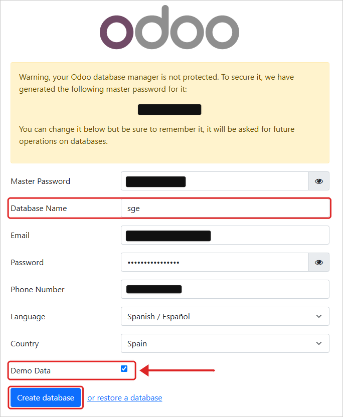

Al pulsar **Create database**, Odoo crea la base de datos `sge` con todas sus tablas y los datos de
prueba. Comprobé que había añadido `admin_passwd` al `odoo.conf` y que había creado la carpeta
`data/filestore/sge`.

Después sale la pantalla de inicio de sesión:

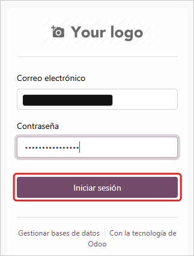

Al entrar aparece la página de **Aplicaciones** con todos los módulos de Odoo:

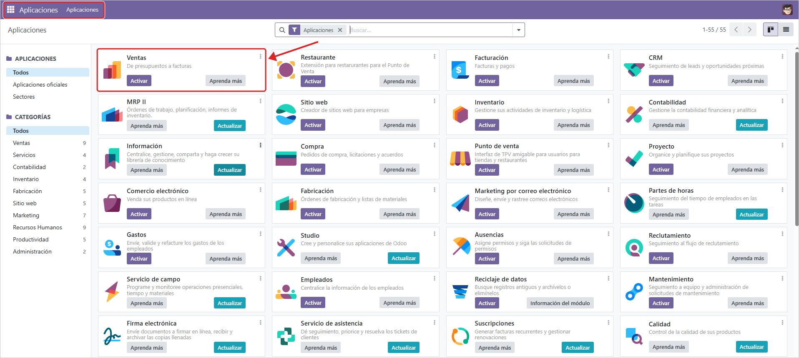

---

## 6. Comprobación de wkhtmltopdf (generación de PDF)

wkhtmltopdf es lo que usa Odoo para generar los PDF. No tuve que instalarlo porque ya viene en la imagen
de Odoo; en los logs del apartado 4 sale la línea `Will use the Wkhtmltopdf binary at
/usr/local/bin/wkhtmltopdf`. Aun así, lo comprobé activando el módulo **Ventas** y sacando el PDF de un
presupuesto.

Módulo Ventas activado, con los presupuestos de prueba:

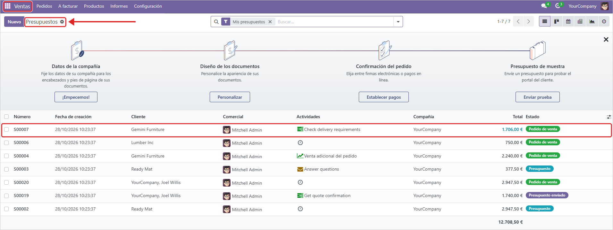

Abrí el presupuesto `S00007` y le di a **⚙ → Imprimir → Presupuesto en PDF**:

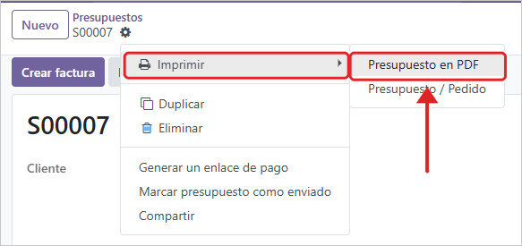

Se descargó el PDF `Pedido - S00007.pdf` sin problemas, así que wkhtmltopdf funciona:

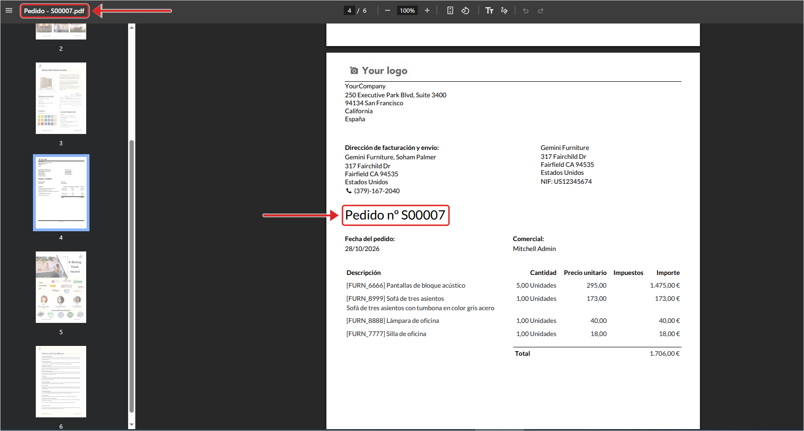

---

## 7. Odoo como servicio

En un contenedor no hay `systemctl`. El contenedor ya hace de servicio y se gestiona desde Portainer.
Estas son las equivalencias:

| Con systemctl            | En Portainer                                                   |
|--------------------------|----------------------------------------------------------------|
| `systemctl stop odoo`    | Botón **Stop** del contenedor `odoo17`                         |
| `systemctl start odoo`   | Botón **Start**                                                |
| `systemctl restart odoo` | Botón **Restart**                                              |
| `systemctl status odoo`  | Estado del contenedor (*running* / *exited*) y sus detalles    |
| `systemctl enable odoo`  | `restart: unless-stopped`                                      |
| Ver el log               | Pestaña *Logs* del contenedor                                  |

**Parar:** el contenedor `odoo17` pasa a *exited - code 0* y deja de estar en el puerto 8069:

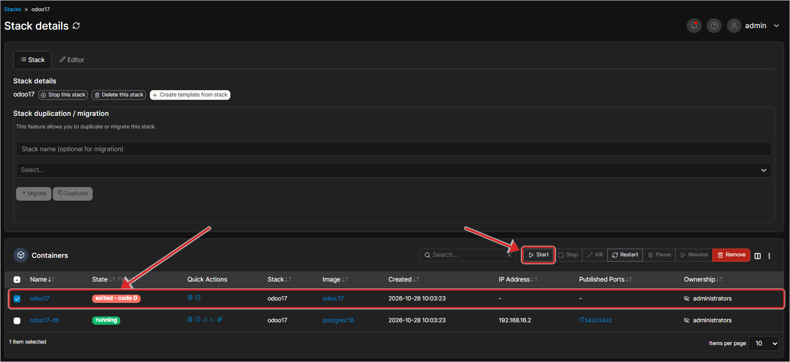

**Arrancar:** vuelve a *running* y otra vez en el puerto 8069:

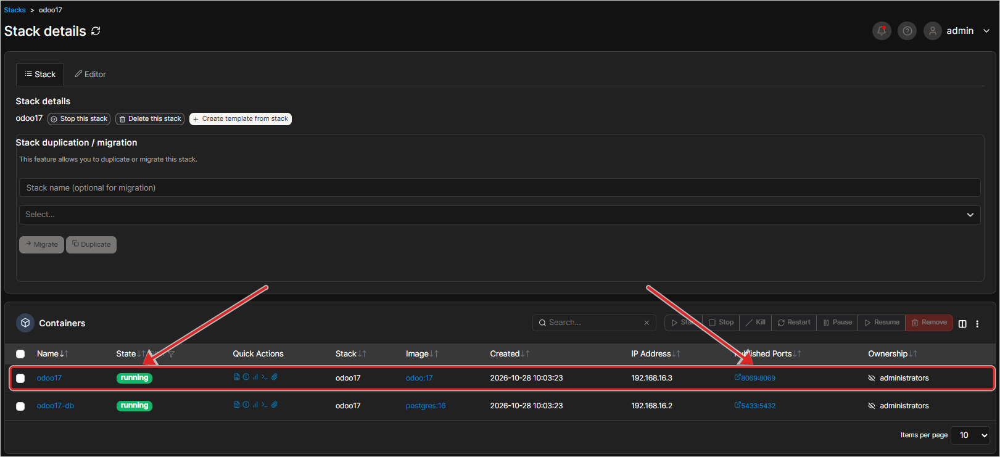

**Reiniciar** con el botón *Restart*:

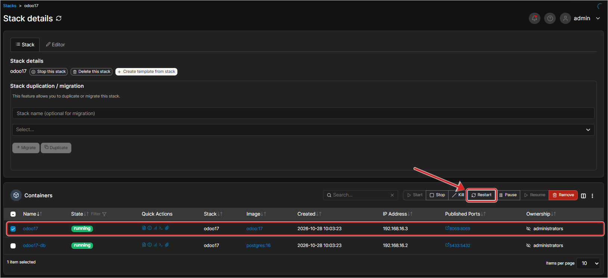

**Estado y configuración:** en los detalles del contenedor se ven los puertos, el comando con el que
arranca (`/entrypoint.sh odoo`) y las variables de entorno. Una de ellas es `ODOO_RC=/etc/odoo/odoo.conf`,
que le indica a Odoo qué fichero de configuración usar:

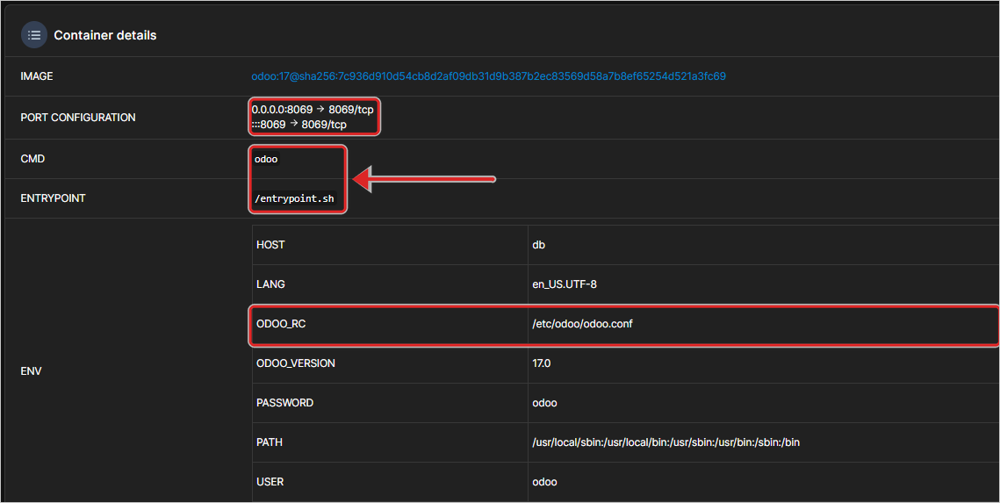

Y la política de reinicio **Unless Stopped**, que hace que Odoo arranque solo al encender el NAS:

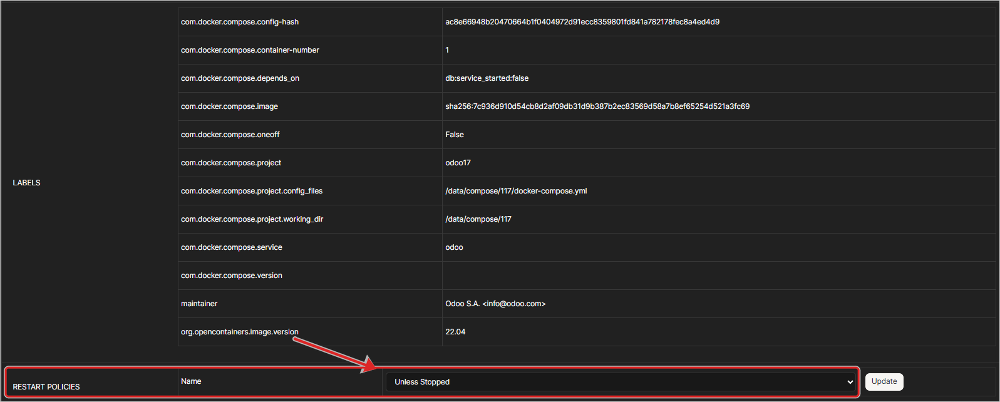

---

## 8. Acceso a la base de datos con `psql`

El usuario `postgres` ya tiene contraseña (`postgres`), porque se la puse al crear el contenedor con
`POSTGRES_PASSWORD`. Desde la consola de `odoo17-db`, con el usuario `postgres`, abrí `psql` y probé estos
comandos:

| Comando               | Qué muestra                                                        |
|-----------------------|--------------------------------------------------------------------|
| `\du`                 | Los roles: `odoo` (Create DB) y `postgres` (Superuser)             |
| `\l`                  | Las bases de datos. `sge` aparece con propietario `odoo`           |
| `\c sge`              | Conectarse a la base de datos de Odoo                              |
| `SELECT count(*) ...` | Cuántas tablas hay en el esquema `public`                          |
| `\dt res_*`           | Las tablas que empiezan por `res_`                                 |
| `\q`                  | Salir                                                              |

Roles y bases de datos. La base de datos `sge` es del usuario `odoo`, porque fue Odoo quien la creó:

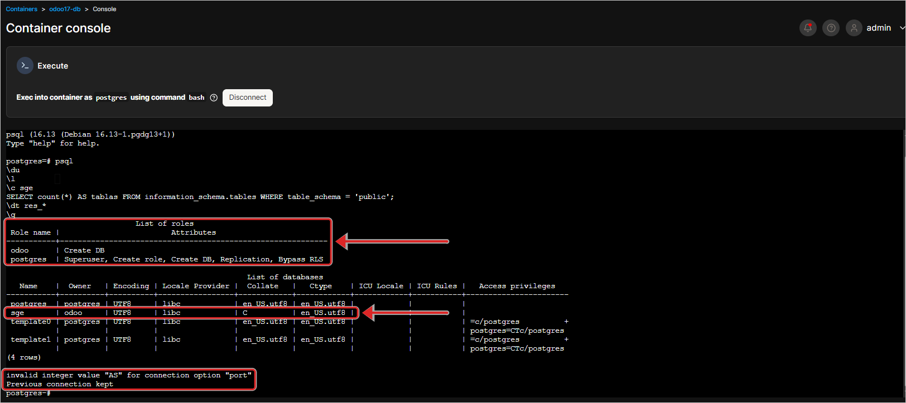

> Abajo del todo se ve un error. Pegué todos los comandos de golpe y `psql` juntó la línea de `\c sge` con
> la siguiente. Lo arreglé vaciando el búfer con `\r` y escribiendo los comandos de uno en uno.

Me conecté a `sge` y conté las tablas. Salen **367**:

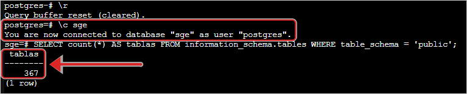

Algunas de las tablas, como `res_partner` (contactos) o `res_company` (empresas). Todas son del usuario
`odoo`:

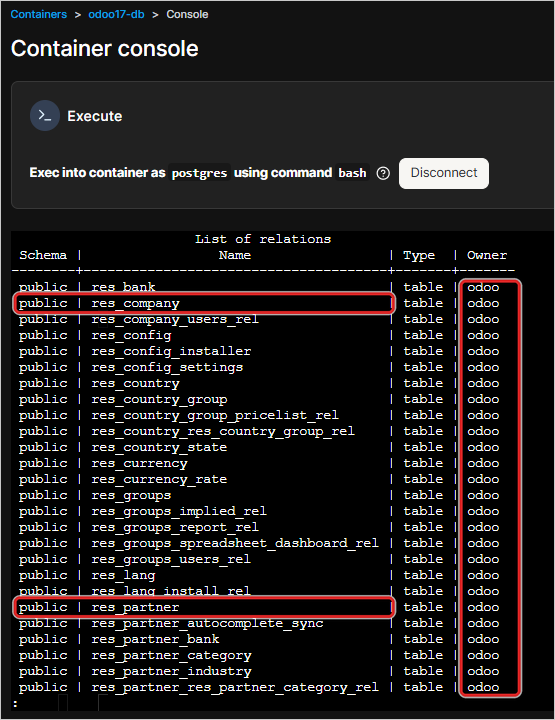

---

## 9. Acceso a la base de datos con pgAdmin

### 9.1. Conexiones remotas en PostgreSQL

Para conectarse desde otro equipo, PostgreSQL tiene que escuchar en todas las interfaces y permitir
conexiones con contraseña desde fuera. Eso se configura en `postgresql.conf` y `pg_hba.conf`, pero la
imagen de PostgreSQL ya viene así. Lo comprobé desde la consola del contenedor:

```bash
grep -E "^listen_addresses" /var/lib/postgresql/data/postgresql.conf
tail -n 3 /var/lib/postgresql/data/pg_hba.conf
```

Sale `listen_addresses = '*'` y la línea `host all all all scram-sha-256`, así que no hay que tocar nada:

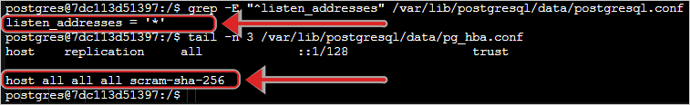

### 9.2. Conexión con el usuario `postgres`

Usé pgAdmin 4 en mi PC con Windows, conectado por VPN:

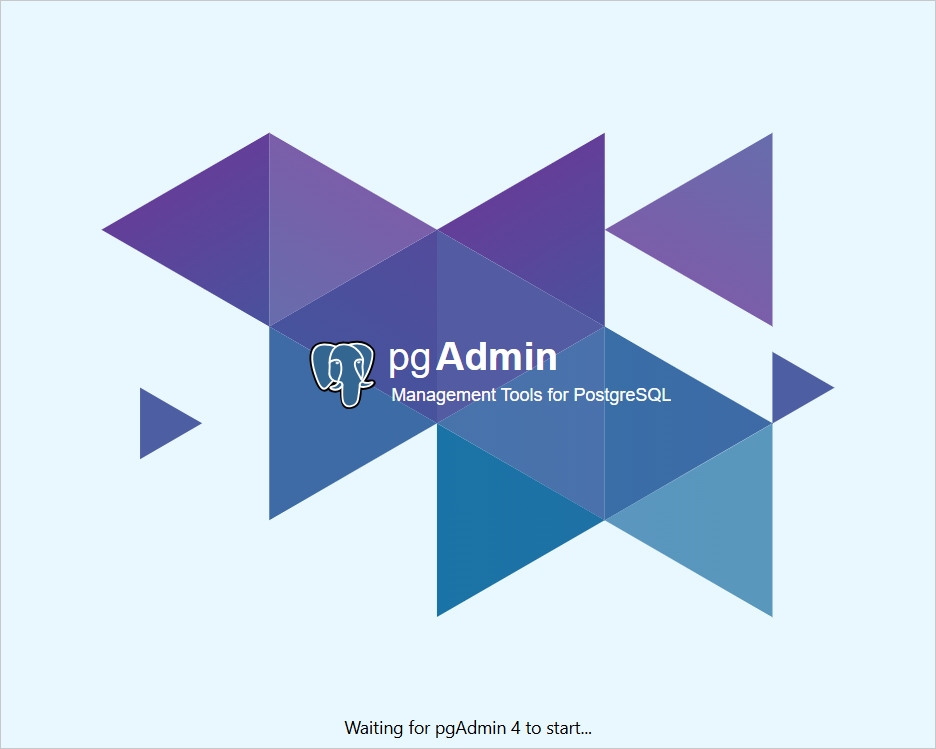

Registré un servidor nuevo (**Register → Server**) con estos datos:

| Campo                | Valor                   | Por qué                                         |
|----------------------|-------------------------|-------------------------------------------------|
| Name                 | `Odoo17 NAS (postgres)` |                                                 |
| Host name/address    | `192.168.1.200`         | La IP del NAS                                   |
| Port                 | `5433`                  | El puerto que publiqué (el 5432 lo usa el NAS)  |
| Maintenance database | `postgres`              |                                                 |
| Username / Password  | `postgres` / `postgres` | El superusuario                                 |

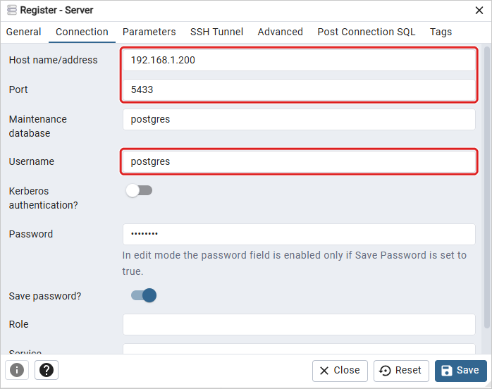

Se conectó bien. En **Databases → sge → Schemas → public → Tables** salen **366 tablas**. En `psql` me
salían 367 porque esa consulta también cuenta las vistas:

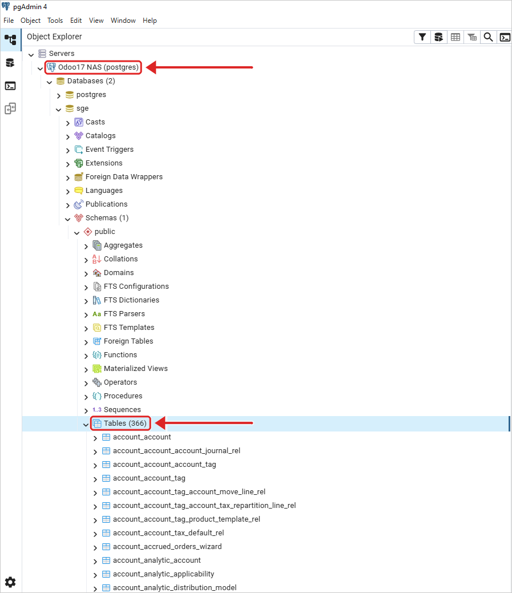

### 9.3. Conexión con el usuario `odoo`

También creé otra conexión con el usuario `odoo`, que no es superusuario y es el que usa Odoo. Los datos
son los mismos, cambiando el usuario y la contraseña a `odoo` / `odoo`:

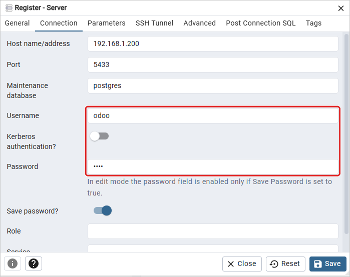

Ya salen las dos conexiones en el *Object Explorer*, y las dos ven la base de datos `sge`:

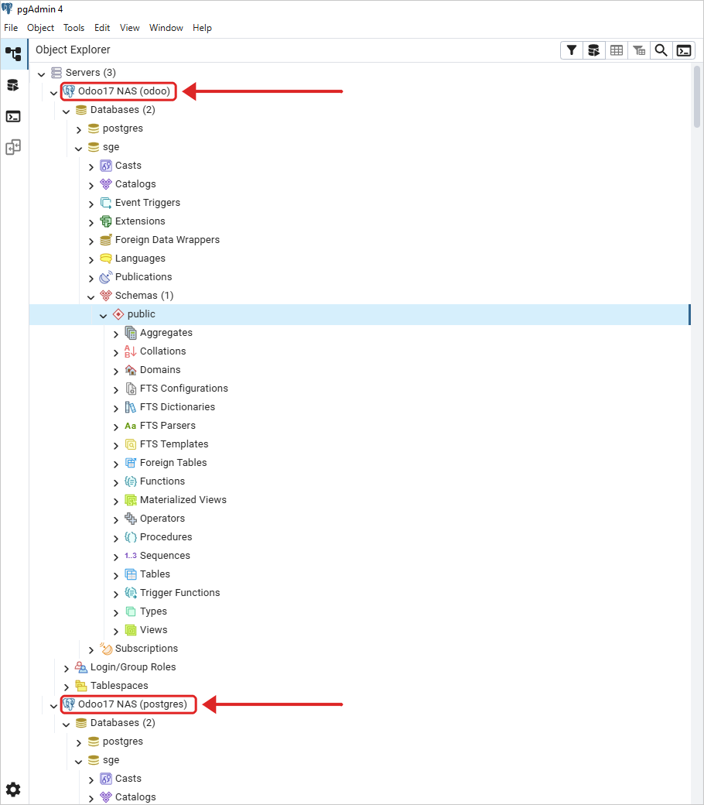

---

## 10. Acceso remoto a Odoo con proxy inverso

Esto no lo pedía la práctica, pero quería poder entrar a Odoo desde cualquier sitio sin conectarme a la
VPN. Para eso usé el proxy inverso del NAS con un dominio de `synology.me` y HTTPS. Antes de abrirlo a
Internet lo protegí un poco más, porque además del login, Odoo tiene un **gestor de bases de datos**
(`/web/database/manager`) desde el que se pueden crear, borrar o descargar bases de datos sabiendo solo la
contraseña maestra.

### 10.1. Cambio de la contraseña maestra

En el apartado 5 dejé la contraseña maestra que genera Odoo (en la captura está tapada). Para que sea más
segura la cambié por una más larga desde **Gestionar bases de datos → Set Master Password**:

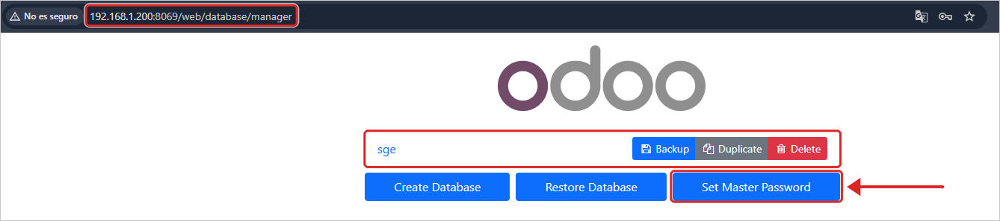

### 10.2. Desactivar el gestor de bases de datos

Como no necesito el gestor desde fuera, lo desactivé. Edité el `odoo.conf` con el Editor de texto del NAS y
añadí estas dos líneas al final:

```ini
list_db = False
dbfilter = ^sge$
```

- `list_db = False` desactiva el gestor de bases de datos.
- `dbfilter = ^sge$` hace que Odoo solo use la base de datos `sge`.

La línea `admin_passwd` es la contraseña maestra cifrada; la dejé tal cual (en la captura está tapada).

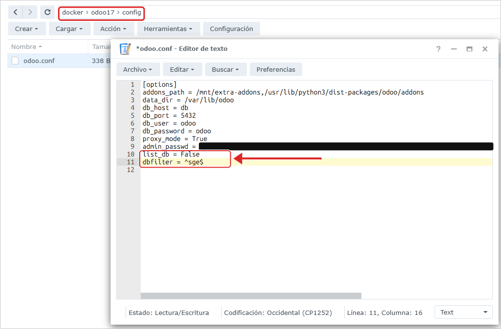

Reinicié `odoo17`. Ahora en `/web/database/manager` sale el mensaje *«The database manager has been
disabled by the administrator»*, y el login sigue funcionando normal.

### 10.3. Proxy inverso en el NAS

En **Panel de control → Portal de inicio de sesión → Avanzado → Proxy inverso** creé una regla que recibe
las peticiones a `odoo.<dominio>.synology.me` por HTTPS y las manda a Odoo, en el puerto 8069 del propio
NAS:

| Parte   | Protocolo | Host                         | Puerto |
|---------|-----------|------------------------------|--------|
| Origen  | HTTPS     | `odoo.<dominio>.synology.me` | 443    |
| Destino | HTTP      | `localhost`                  | 8069   |

El certificado HTTPS lo pone el NAS, así que Odoo no tiene que encargarse de eso. Por esto puse
`proxy_mode = True` en el `odoo.conf`: así Odoo sabe que está detrás de un proxy.

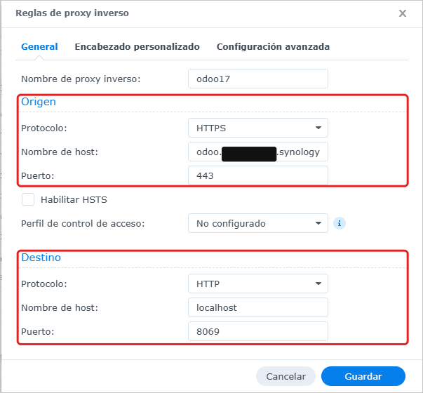

En **Encabezado personalizado → Crear → WebSocket** añadí las cabeceras `Upgrade` y `Connection`. Odoo 17
usa WebSocket para el chat y las notificaciones, y sin ellas no funcionan. También subí los tiempos de
espera a 600 segundos en *Configuración avanzada*, porque instalar un módulo puede tardar más de los 60
que vienen por defecto.

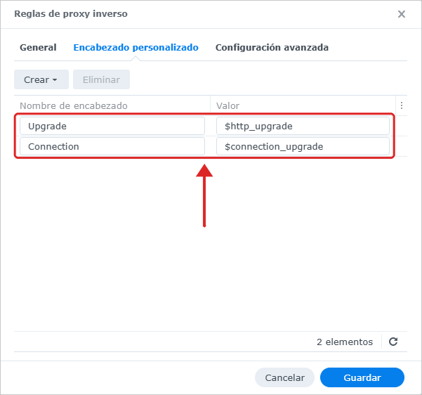

### 10.4. Prueba desde fuera

Desconecté la VPN, entré a `https://odoo.<dominio>.synology.me` y me salió el login de Odoo con HTTPS:

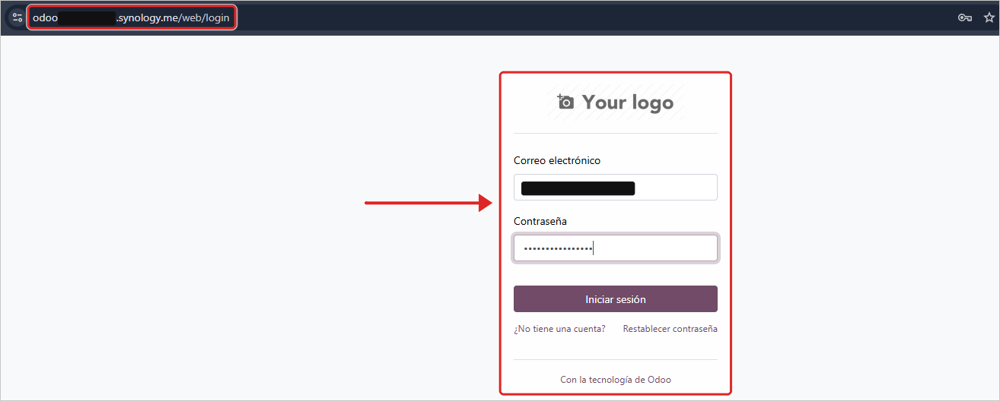

También comprobé estas cosas desde fuera de casa:

| Prueba                         | Resultado                                                     |
|--------------------------------|---------------------------------------------------------------|
| `/web/login` por HTTPS         | Carga bien y el certificado es válido                         |
| `/web/database/manager`        | «The database manager has been disabled by the administrator» |
| `/websocket`                   | `101 Switching Protocols`, el WebSocket funciona              |
| `http://` (puerto 80)          | Cerrado, solo se puede entrar por HTTPS                       |

### 10.5. Desactivar el registro libre

En el login salía el enlace *«¿No tiene una cuenta?»*, o sea, que cualquiera podía crearse una cuenta desde
Internet. Lo cambié en **Ajustes → Opciones generales → Permisos → Cuenta de cliente**, de *Registro libre*
a **Por invitación**:

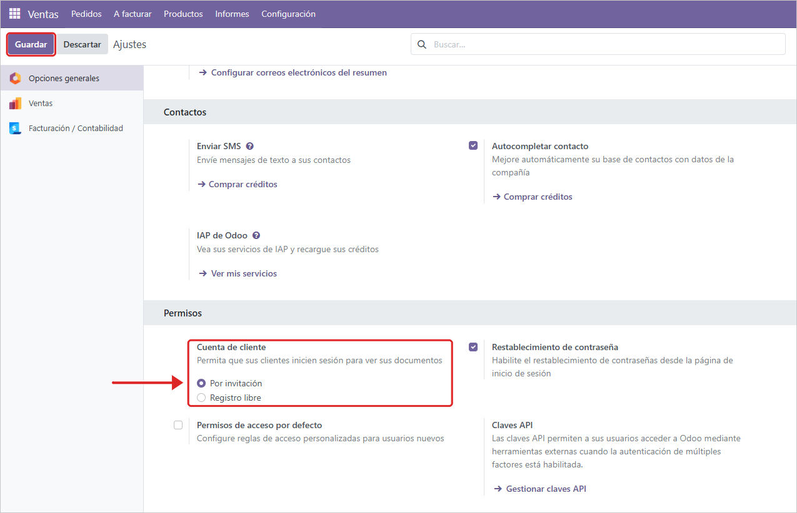

Ahora `/web/signup` da error **404** y el enlace ya no aparece en el login.

---

## 11. Bibliografía

**Docker**

- Referencia de servicios en Docker Compose (`image`, `environment`, `volumes`, `ports`, `depends_on`,
  `restart`). <https://docs.docker.com/reference/compose-file/services/>
- Imagen oficial de Odoo (variables `HOST`, `USER` y `PASSWORD`, `/etc/odoo` y `/mnt/extra-addons`).
  <https://hub.docker.com/_/odoo>
- Imagen oficial de PostgreSQL (variables `POSTGRES_*` y carpeta de datos).
  <https://hub.docker.com/_/postgres>

**Portainer**

- Crear un stack. <https://docs.portainer.io/user/docker/stacks/add>
- Consola de un contenedor. <https://docs.portainer.io/user/docker/containers/console>
- Logs de un contenedor. <https://docs.portainer.io/user/docker/containers/logs>

**Odoo 17**

- Configuración del sistema (`proxy_mode`, `dbfilter`, listado de bases de datos y proxy inverso).
  <https://www.odoo.com/documentation/17.0/administration/on_premise/deploy.html>
- Acceso al portal de clientes. <https://www.odoo.com/documentation/17.0/applications/general/users/portal.html>
- wkhtmltopdf, la herramienta que usa Odoo para generar los PDF. <https://wkhtmltopdf.org/>

**PostgreSQL 16**

- `createuser`. <https://www.postgresql.org/docs/16/app-createuser.html>
- `psql`. <https://www.postgresql.org/docs/16/app-psql.html>
- Conexiones y `listen_addresses`. <https://www.postgresql.org/docs/16/runtime-config-connection.html>
- Fichero `pg_hba.conf`. <https://www.postgresql.org/docs/16/auth-pg-hba-conf.html>

**pgAdmin 4**

- Descarga. <https://www.pgadmin.org/download/>
- Registrar un servidor. <https://www.pgadmin.org/docs/pgadmin4/latest/server_dialog.html>

**Synology DSM**

- File Station. <https://kb.synology.com/es-es/DSM/help/FileStation/FileBrowser_desc?version=7>
- Proxy inverso. <https://kb.synology.com/es-es/DSM/help/DSM/AdminCenter/system_login_portal_advanced?version=7>
